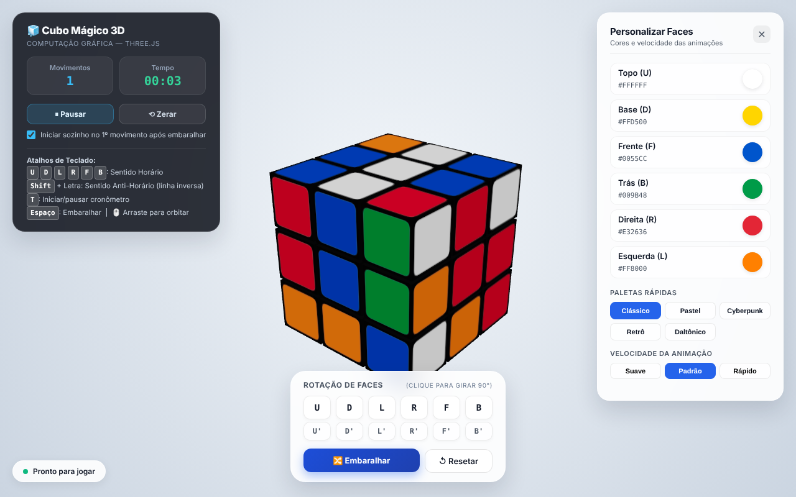

# 🧊 Cubo Mágico 3D (Rubik's Cube) — Computação Gráfica

Projeto final prático desenvolvido para a disciplina de **Computação Gráfica** do curso de **Ciência da Computação** da Universidade Católica de Pernambuco (UNICAP), sob orientação do Prof. Pedro Ximenes.

O projeto consiste em uma simulação interativa tridimensional completa de um **Cubo Mágico 3×3×3** em **Three.js**, com câmera orbital, iluminação realista, agrupamento dinâmico via grafo de cena (`THREE.Group`), interpolação angular suave, eliminação de deriva numérica, detecção automática de vitória, cronômetro opcional e temas de cores personalizáveis.



## 📑 Sumário

1. [Divisão oficial da equipe](#-divisão-oficial-da-equipe)
2. [Como executar](#-como-executar)
3. [Controles e interação](#️-controles-e-interação)
4. [Regras do jogo](#-regras-do-jogo)
5. [Arquitetura técnica](#-arquitetura-técnica-e-conceitos-de-computação-gráfica)
6. [Testes](#-testes)
7. [Estrutura do repositório](#-estrutura-do-repositório)
8. [Declaração de uso de inteligência artificial](#-declaração-de-uso-de-inteligência-artificial)

---

## 👥 Divisão Oficial da Equipe

| Integrante | Papel | Responsabilidades |
| :--- | :--- | :--- |
| **Guilherme Maciel** | Integrante 1 | **Estrutura 3D e Câmera:** Configuração da cena Three.js, perspectiva da câmera, iluminação direcional/ambiente, OrbitControls e instanciação da malha dos 27 cubinhos com materiais das 6 faces. |
| **Guilherme Raposo** | Integrante 2 | **Movimentação e Mecânicas:** Lógica de agrupamento dinâmico por coordenadas de mundo, rotação das 6 faces (U, D, L, R, F, B), animações com interpolação suave (cubic easing), ancoragem sem perda de precisão (zero drift), fila de movimentos assíncrona, algoritmo de embaralhar (scramble) e atalhos de teclado. |
| **Paulo Neto** | Integrante 3 | **Interface, Extras e Integração:** Interface de controles visuais, cronômetro e contador de movimentos, detecção matemática de vitória, paletas de cores personalizáveis em tempo real, integração dos módulos, testes gerais e documentação. |

---

## 🚀 Como Executar

O projeto roda diretamente no navegador, sem etapa de compilação. O Three.js é carregado por CDN, então é preciso estar conectado à internet.

### Opção 1: Abrir diretamente no navegador
Dê um duplo clique no arquivo `index.html` (Google Chrome, Firefox, Edge ou Safari).

### Opção 2: Servidor local HTTP (recomendado)
Para evitar restrições locais de segurança em alguns navegadores, execute no terminal dentro da pasta do projeto:

```bash
# Com Python 3:
python3 -m http.server 8080

# Ou com Node.js (se instalado):
npx serve .
```

Em seguida, acesse no navegador: `http://localhost:8080`

---

## 🎮 Controles e Interação

### 🖱️ Mouse
* **Clique com botão esquerdo + arrastar:** orbita a câmera 3D em torno do cubo.
* **Scroll da roda do mouse:** zoom in / zoom out.

### ⌨️ Atalhos de Teclado

| Tecla | Ação |
| :--- | :--- |
| <kbd>U</kbd> <kbd>D</kbd> <kbd>L</kbd> <kbd>R</kbd> <kbd>F</kbd> <kbd>B</kbd> | Gira a face Superior (**Up**), Inferior (**Down**), Esquerda (**Left**), Direita (**Right**), Frontal (**Front**) ou Traseira (**Back**) no sentido horário |
| <kbd>Shift</kbd> + letra | Mesma face no sentido anti-horário (U', D', L', R', F', B') |
| <kbd>Espaço</kbd> | Embaralha o cubo com 20 movimentos |
| <kbd>T</kbd> | Inicia / pausa o cronômetro |

Os atalhos do navegador continuam funcionando: combinações com <kbd>Ctrl</kbd>, <kbd>Cmd</kbd> ou <kbd>Alt</kbd> (como <kbd>Ctrl</kbd>+<kbd>R</kbd> para recarregar) não giram o cubo, e manter uma tecla pressionada não enche a fila de movimentos.

### 🎛️ Painel na Tela
* **Botões de rotação:** barra inferior para girar cada uma das 6 faces nos dois sentidos.
* **Embaralhar:** 20 giros aleatórios sem repetir a mesma face em sequência. Durante o embaralhamento os demais comandos ficam bloqueados.
* **Resetar:** reconstrói o cubo resolvido na hora (também cancela um embaralhamento em andamento).
* **Cronômetro:** botões **▶ Iniciar / ⏸ Pausar / ▶ Continuar** e **⟲ Zerar**, mais a opção *"Iniciar sozinho no 1º movimento após embaralhar"*.
* **Personalizar faces:** seletor de cor para cada face e cinco paletas rápidas — *Clássico*, *Pastel*, *Cyberpunk*, *Retrô* e *Daltônico* (paleta Okabe-Ito, distinguível por quem tem daltonismo).
* **Velocidade da animação:** *Suave* (400 ms), *Padrão* (240 ms) ou *Rápido* (110 ms).

As preferências de cores, velocidade e cronômetro automático ficam salvas no navegador (`localStorage`) e voltam na próxima visita.

---

## 📏 Regras do Jogo

* **Contador de movimentos:** cada giro de 90° conta 1 movimento (U e U' contam 1 cada). Ele zera quando o embaralhamento termina e ao resetar.
* **Cronômetro (opcional):**
  * Com a opção automática ligada (padrão), ele começa sozinho no **primeiro giro depois de embaralhar** e para quando o cubo é resolvido.
  * Sem embaralhar (modo livre), o cronômetro **não** inicia sozinho. Use **▶ Iniciar** ou a tecla <kbd>T</kbd> quando quiser cronometrar.
  * Dá para pausar, continuar e zerar a qualquer momento. Embaralhar ou resetar zera o tempo.
* **Vitória:** só é detectada em uma partida iniciada pelo botão **Embaralhar**. Ao resolver o cubo aparece um aviso com o total de movimentos e o tempo, e o aviso só volta a aparecer em um novo embaralhamento.

---

## 🧠 Arquitetura Técnica e Conceitos de Computação Gráfica

### 1. Construção Procedural dos 27 Cubinhos (Grid 3×3×3)
Em vez de carregar um modelo único estático ou monolítico, o cubo mágico é montado a partir de 27 malhas (`THREE.Mesh`) independentes posicionadas no espaço discreto $(x, y, z) \in \{-1, 0, 1\}$.
* Cada cubinho recebe uma `THREE.BoxGeometry(0.95, 0.95, 0.95)`. O tamanho de 0.95 garante um vão realista de 0.05 entre as peças, simulando os canais plásticos de um cubo real.
* As faces internas recebem material preto fosco (`#141416`), e as faces externas recebem materiais com texturas de adesivos chanfrados geradas proceduralmente via HTML5 Canvas.

### 2. Agrupamento Dinâmico por Coordenadas de Mundo (`THREE.Group`)
Para girar uma face, é necessário identificar dinamicamente quais cubos pertencem a ela no instante atual.
* A função `obterCubinhosDaFace(face)` consulta `cubo.getWorldPosition(posMundo)`.
* Para a face **U** ($+Y$), seleciona os cubos onde $y_{mundo} > 0.5$. Para **D** ($-Y$), $y_{mundo} < -0.5$. O mesmo se aplica para **R** ($+X$), **L** ($-X$), **F** ($+Z$) e **B** ($-Z$).
* Cria-se um grupo pivô temporário (`grupoPivo = new THREE.Group()`) na origem $(0, 0, 0)$.
* Utiliza-se `grupoPivo.attach(cubo)` para cada um dos 9 cubinhos. O método `attach` do Three.js é fundamental pois altera a hierarquia preservando exatamente a transformação mundial (posição, rotação e escala) do objeto.

### 3. Interpolação Suave e Easing
A rotação é calculada a cada quadro via `requestAnimationFrame`:
$$\theta(t) = \theta_{alvo} \cdot f(t)$$
onde $t = \frac{\Delta \text{tempo}}{\text{duração}} \in [0, 1]$ e $f(t)$ é a função de atenuação cúbica (*Ease In-Out*):
$$f(t) = \begin{cases} 4t^3 & \text{se } t < 0.5 \\ 1 - \frac{(-2t + 2)^3}{2} & \text{se } t \ge 0.5 \end{cases}$$

### 4. Zero Drift e Eliminação de Erro Numérico
Em transformações 3D cumulativas, arredondamentos de ponto flutuante em funções trigonométricas ($\sin(\frac{\pi}{2})$, $\cos(\frac{\pi}{2})$) causam deformações após sucessivos giros.
Para garantir precisão matemática:
1. Ao término do giro, os cubos são reancorados à cena com `scene.attach(cubo)`.
2. As posições são arredondadas para os inteiros ortogonais exatos:
   $$\vec{p} = (\text{round}(x), \text{round}(y), \text{round}(z))$$
3. A matriz de rotação $3 \times 3$ é alinhada ortogonalmente arredondando cada elemento das colunas de base para $\{-1, 0, 1\}$, reconstituindo o quaternion.

Medição nos testes automáticos (150 giros aleatórios): desvio de posição **exatamente 0** e desvio de rotação de **≈ 2,2 × 10⁻¹⁶** (um épsilon de máquina, que vem de o quaternion não representar $\sqrt{1/2}$ com exatidão) e que **não acumula** com o número de giros.

### 5. Fila de Movimentos Assíncrona (Move Queue)
Evita race conditions quando múltiplos botões ou teclas são pressionados em sequência, ou durante o processo de embaralhamento. Cada movimento é adicionado a uma fila FIFO (`filaMovimentos`), processando o próximo assim que o atual atinge 100% de conclusão. O fim do embaralhamento é tratado por um callback disparado quando a fila esvazia (`aoEsvaziarFila`), que o botão Resetar consegue cancelar.

### 6. Detecção de Vitória Invariante a Rotações Globais
A verificação de vitória não exige que o cubo esteja na orientação original absoluta; ela verifica a consistência das 6 faces exteriores (`cuboEstaResolvido()`):
* Para cada face normal canônica, obtém-se os 9 cubinhos.
* Calcula-se o produto escalar do vetor normal de cada adesivo no espaço de mundo com a normal da face $(\vec{n}_{adesivo} \cdot \vec{n}_{face} > 0.85)$.
* Se todos os 9 adesivos externos apontando para aquela face compartilharem o mesmo material, a face é considerada uniforme. Se as 6 faces forem uniformes, a vitória é declarada.

### 7. Cronômetro com Pausa
O cronômetro guarda o **tempo acumulado** (`acumuladoMs`) e o instante em que voltou a rodar (`inicioMs`). O tempo exibido é `acumuladoMs + (agora − inicioMs)` enquanto roda, o que permite pausar, continuar e zerar sem perder precisão.

### 8. Temas e Persistência
Cada face usa um material compartilhado (`MeshStandardMaterial`) cuja textura de adesivo é regerada no Canvas quando a cor muda, então trocar de tema atualiza as 54 etiquetas de uma vez. As escolhas são gravadas em `localStorage` e validadas ao carregar (cores `#rrggbb`, velocidades conhecidas), de modo que um valor salvo corrompido é ignorado sem quebrar a página.

---

## 🧪 Testes

### Testes automáticos
A suíte em [`tests/`](tests/) abre o `index.html` **real** em um Chrome headless (com WebGL por software) e usa o jogo como um usuário: cliques, teclado, embaralhar, vitória, cronômetro, temas e recarregamento da página. O Three.js é servido de `node_modules`, então os testes não dependem de internet.

```bash
cd tests
npm install
npm test
```

Requer Node.js 18+ e Google Chrome (ou Edge) instalado. Se o navegador estiver em outro caminho: `CHROME_PATH="/caminho/do/chrome" npm test`. Para rodar só alguns testes: `FILTRO="cronômetro" npm test`.

| Área | O que é verificado |
| :--- | :--- |
| Estrutura | 27 cubinhos únicos em posições inteiras, cubo inicial resolvido, página sem erros |
| Movimentação | 4 giros de cada face voltam ao estado inicial; horário + anti-horário se anulam; sentido de U/D/L/R/F/B conforme a notação oficial; algoritmo `R U R' U'` com ordem 6; 150 giros aleatórios + inversa (zero drift) |
| Interface | 12 botões de giro e contador; atalhos com Shift; `Ctrl+R` e tecla repetida ignorados; foco devolvido ao jogo depois de clicar em botões |
| Embaralhar/Resetar | entradas bloqueadas durante o embaralhamento; métricas zeradas ao final; resetar no meio cancela tudo |
| Vitória | desfazer os 20 giros do embaralhamento mostra o aviso (com movimentos e tempo); 19 de 20 não conta; o aviso não reaparece |
| Cronômetro | modo livre sem início automático; iniciar, pausar, continuar (`T`) e zerar; início automático após embaralhar e opção de desligar |
| Temas | as 5 paletas atualizam seletores e texturas 3D; cor personalizada; persistência após recarregar; configuração salva corrompida é ignorada |

### Roteiro manual (o que a automação não cobre)
1. Arraste com o mouse para orbitar e use o scroll para dar zoom; o cubo deve continuar centralizado e legível.
2. Feche o painel de cores no **✕** e reabra em **🎨 Personalizar Cores**.
3. Abra o seletor de cor de uma face e confira a atualização em tempo real no cubo.
4. Embaralhe, resolva o cubo à mão e confira o aviso de vitória e o tempo final.
5. Redimensione a janela e confira que o cubo acompanha o novo tamanho.

---

## 🗂️ Estrutura do Repositório

```
.
├── index.html                # Aplicação completa (HTML + CSS + JavaScript/Three.js)
├── README.md                 # Este documento
├── docs/
│   └── screenshot.png        # Captura de tela usada no README
├── tests/
│   ├── package.json          # Dependências dos testes (puppeteer-core e three)
│   └── testes-gerais.mjs     # Suíte de testes automáticos
├── chat antigravity.md       # Registro dos prompts usados com o Google Antigravity
└── todo.txt                  # Anotações de pendências da equipe
```

---

## 🤖 Declaração de Uso de Inteligência Artificial

Em conformidade com as instruções e exigências éticas do projeto:

### Ferramenta 1: Google Antigravity / Gemini 3.8
* **Objetivo do uso:**
  1. Identificação do gargalo técnico do protótipo inicial (substituição do modelo `.glb` monolítico pela arquitetura procedural correta de 27 cubinhos em Three.js).
  2. Implementação das rotinas matemáticas de rotação via `THREE.Group` e cálculo de interpolação angular suave.
  3. Resolução da acumulação de erros de ponto flutuante nas rotações (snapping de coordenadas e matriz ortonormal).
  4. Formulação do algoritmo de detecção de vitória vetorial.
* **Prompts principais utilizados:**
  - *"Como agrupar dinamicamente os 9 cubinhos de uma face no Three.js usando `THREE.Group` e `attach` sem quebrar as transformações mundiais?"*
  - *"Como evitar acúmulo de erro de precisão numérica de ponto flutuante nas rotações sucessivas do cubo mágico em Three.js?"*
  - *"Implementação de interpolação suave com easing cúbico para animação de faces em Three.js."*
  - *"Lógica para detecção de vitória no cubo mágico 3D calculando a normal no espaço de mundo dos materiais de cada peça."*
* O registro completo da conversa está em [`chat antigravity.md`](chat%20antigravity.md).

### Ferramenta 2: Claude Sonnet 5.5 (Anthropic)
* **Objetivo do uso:** fase de integração e acabamento (parte do Integrante 3):
  1. Diagnóstico do cronômetro que não iniciava (item do `todo.txt`): ele só começava depois de usar o botão Embaralhar. Foi refeito como cronômetro opcional, com iniciar/pausar/continuar/zerar e início automático configurável.
  2. Correções de integração: tecla `Ctrl+R` (e outros atalhos do navegador) girando o cubo em vez de funcionar; Espaço pressionado durante o embaralhamento empilhando embaralhamentos; Resetar durante o embaralhamento deixando uma "partida fantasma"; aviso de vitória reaparecendo; cubo parcialmente escondido atrás do painel inferior.
  3. Temas de cores: duas novas paletas (Retrô e Daltônico), destaque da paleta ativa e persistência das preferências em `localStorage`.
  4. Suíte de testes automáticos em Chrome headless (17 testes) e organização deste README.
* **Prompt principal utilizado:**
  - *"Criar interface e botões de controle. Implementar contador de movimentos. Implementar detecção de vitória. Criar temas de cores personalizáveis. Integrar os módulos. Realizar testes gerais. Organizar README.md — pode fazer isso nesse projeto [https://github.com/GuilhermeADS13/Cubo-magico-cgi]"*
* Todo o código gerado foi executado e conferido pelos testes automáticos descritos acima.
